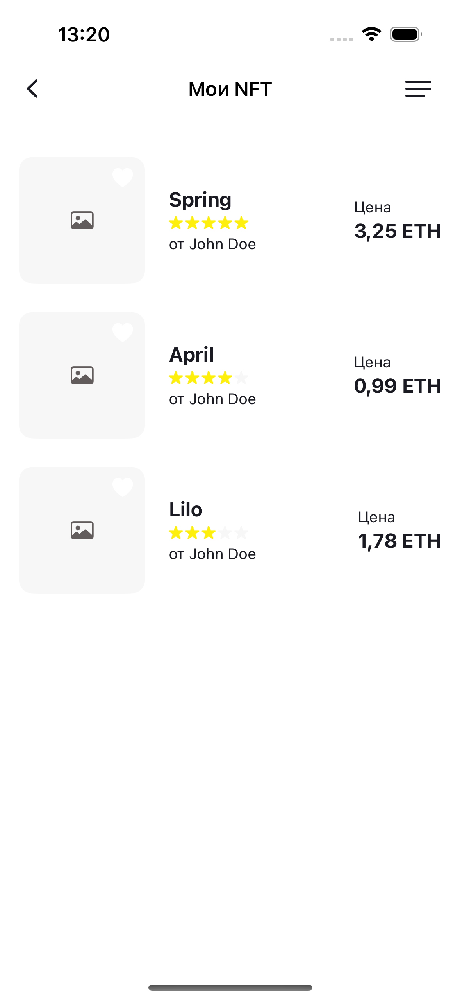
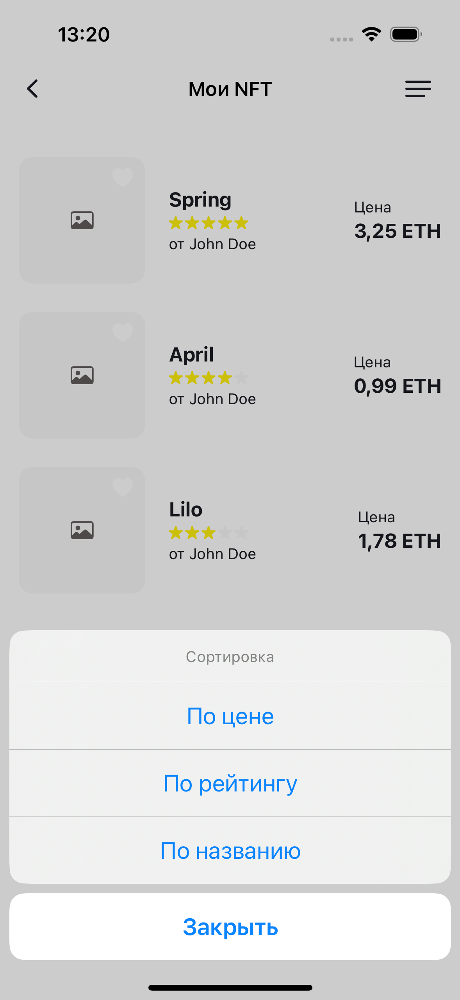
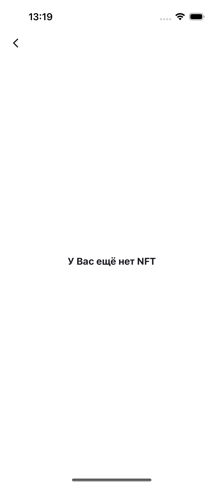
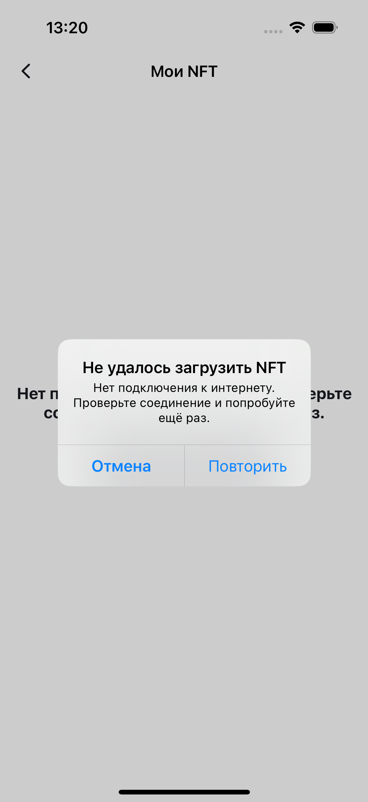

# Профиль — вторая итерация (2/3)

Ответственный: AntonA22. Эпик: [#36](https://github.com/shaggybee/iOS-FakeNFT/issues/36). [Общая доска](https://github.com/users/shaggybee/projects/1).

PR второй итерации: [#89 — Мои NFT и сохранение сортировки](https://github.com/shaggybee/iOS-FakeNFT/pull/89).

## Объём сдачи

В приложении доступны первая и вторая части эпика: основной профиль, редактирование, сайт пользователя и список «Мои NFT». Первая часть одобрена Kirchberg и слита [PR #54](https://github.com/shaggybee/iOS-FakeNFT/pull/54). Новая ветка feature/profile-iteration-2 создана от epic/profile после этого слияния (база: 68cba59).

Во второй части реализованы:

- переход из профиля в «Мои NFT», возврат и восстановление таббара;
- List с изображением 108×108, названием NFT, рейтингом, именем автора и ценой в ETH;
- получение NFT по массиву nfts текущего профиля, загрузка авторов по их ID;
- удаление повторяющихся ID и один запрос на каждого автора в рамках загрузки;
- не более четырёх одновременных запросов на каждом этапе;
- сортировка по цене по возрастанию, рейтингу по убыванию и названию; равные значения упорядочиваются по названию и ID;
- рейтинг по умолчанию, сохранение выбора в UserDefaults под отдельным ключом профиля;
- загрузка, пустой список, ошибка с алертом и повтором, повтор после закрытия алерта и pull-to-refresh;
- отмена загрузки без ложного сообщения об ошибке и защита от повторных запросов.

Сердце на изображении показывает текущее состояние из likes. Изменение избранного и отдельная сетка избранных NFT относятся к третьей итерации. На этом экране сердце является индикатором состояния.

## Источники и архитектура

[Урок «2/3 эпика»](https://practicum.yandex.ru/learn/ios-developer-plus/courses/f0ec832a-7a13-49ca-b48a-0aabfffd0586/sprints/675013/topics/ad318513-c794-46ef-8c6c-fe80cc8673c7/lessons/25f2ee7f-a227-4f39-91ff-255192896c53/) и [макет «Мои NFT»](https://www.figma.com/design/Uz5G39wRRCr2mRE4SbnNla/FakeNFT--YP-?node-id=46936-13590) изучены в Яндекс Браузере 29.10.2026. ТЗ — Readme-SwiftUI.md, схема API — API.html и cloud.postman_collection.json.

SwiftUI + MVVM, @Observable и @MainActor для ViewModel, actor/Sendable для сервисов и данных, async/await и withThrowingTaskGroup. Минимальная iOS — 17.0. Общие RatingView, LoadingView, EmptyStateView, ErrorStateView и сетевой клиент переиспользованы.

Общая модель Nft дополнена полями API. NftServiceImpl переведён на actor, NftStorage — Sendable; существующий кэш сохранён. ProfileNFTsServiceImpl объединяет NFT и авторов. ProfileNFTsViewModel управляет состояниями и сортировкой; отдельный ProfileNFTSortStore отвечает за локальное хранение.

Список получает массивы nfts/likes из загруженного профиля при открытии. Чтобы перечитать изменённый на сервере состав NFT, нужно обновить профиль перед открытием списка. Pull-to-refresh списка повторяет загрузку NFT/авторов по этим ID; кэш NFT используется общим сервисом.

## Проверки

Открыть iOS-FakeNFT-Extended.xcodeproj, выбрать схему iOS-FakeNFT-Extended и симулятор с iOS 17+. Учебный API_TOKEN должен находиться в игнорируемом Configurations/Secrets.xcconfig (образец — Secrets.xcconfig.example). Запустить приложение и открыть «Мои NFT» из профиля; тесты запускаются через Product → Test.

Debug-сборка на iPhone 16 / iOS 18.4, Xcode 16.3 — успешно. **32 unit-теста и 7 UI-сценариев прошли.** Основной прогон проверил все unit-тесты и четыре прежних UI-сценария; три новых UI-сценария отдельно прошли после исправления области нажатия строки «Мои NFT».

Проверены декодирование и некорректные данные, получение нужных ID, повторяющиеся ID/авторы, кэш и предел параллельных запросов, три сортировки и равные значения, сохранение выбора, ошибка/повтор, отмена и защита от дубликатов загрузки. UI-тесты проверяют пустой список, возврат и таббар, закрытие алерта с повтором, сортировки и восстановление выбора после полного перезапуска приложения.

Результаты сохранены вне репозитория: work/ProfileIteration2.xcresult (основной прогон) и work/ProfileIteration2Navigation.xcresult (успешная повторная проверка новых UI-сценариев).

Сетевой сервис тестируется через изолированный NetworkClient; UI-сценарии запускаются только с явным DEBUG-аргументом --profile-ui-testing. В обычном запуске используется настоящий API, автоматической подмены при сбое нет.

Дополнительные аргументы UI-тестов:

- --profile-empty-nfts — профиль без NFT;
- --profile-nfts-fail-first-load — первая загрузка списка завершается ошибкой, повтор успешен;
- -Profile.myNFTs.sort rating — начальное значение сортировки для одного тестового запуска; после перезапуска без аргумента проверяется сохранённый выбор.

Изображения тестовых NFT запрашиваются по адресам из учебного набора. Проверка с компьютера вернула HTTP 200 и корректный PNG, но отдельный запрос URLSession из симулятора завершился ошибкой DNS NSURLErrorDomain -1003 (cannotFindHost). Поэтому на снимках показаны заглушки изображений; успешная загрузка картинок в симуляторе не подтверждена. Временная сетевая диагностика сохранена в work/ProfileImageDiagnostic.xcresult и image-diagnostic.log; она не входит в постоянный набор из 32 unit-тестов.

## Внешнее ограничение API

29.10.2026 GET /api/v1/profile/1 и GET /api/v1/nft?page=1&size=1 с выданным когортным токеном вернули HTTP 502. Успешная загрузка списка с живого сервера пока не подтверждена. Реальные PUT-запросы при подготовке этой итерации не выполнялись.

После восстановления доступности API и DNS симулятора нужно повторно проверить профиль, получение его NFT/авторов и изображения на живых данных.

## Снимки UI-тестов — тестовые данные

Из-за DNS-ограничения симулятора изображения NFT отображаются заглушками.

| Мои NFT | Сортировка | Пустой список | Ошибка |
|---|---|---|---|
|  |  |  |  |

## Прогресс и ревью

Задачи: [P7 #43](https://github.com/shaggybee/iOS-FakeNFT/issues/43), [P8 #44](https://github.com/shaggybee/iOS-FakeNFT/issues/44), [P9 #45](https://github.com/shaggybee/iOS-FakeNFT/issues/45), [P10 #46](https://github.com/shaggybee/iOS-FakeNFT/issues/46), [P11 #47](https://github.com/shaggybee/iOS-FakeNFT/issues/47).

Оценки и границы частей — [декомпозиция](profile-decomposition.md); фактические интервалы — [worklog](profile-worklog.md).

По уроку для сдачи требуется взаимное ревью с партнёром по команде: комментарии, обработка замечаний и финальный approve. Партнёр пока не выбран, этот этап не завершён. Самопроверка и автотесты не засчитываются как командное ревью. После approve можно отправить ссылку на PR во вкладке «Ревью» урока «2/3 эпика».
