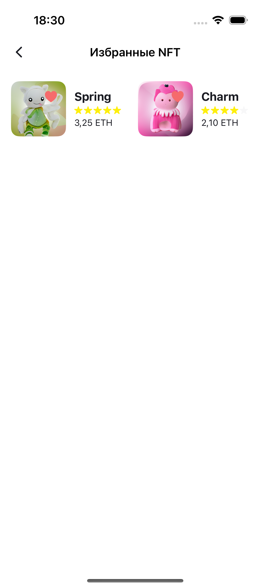
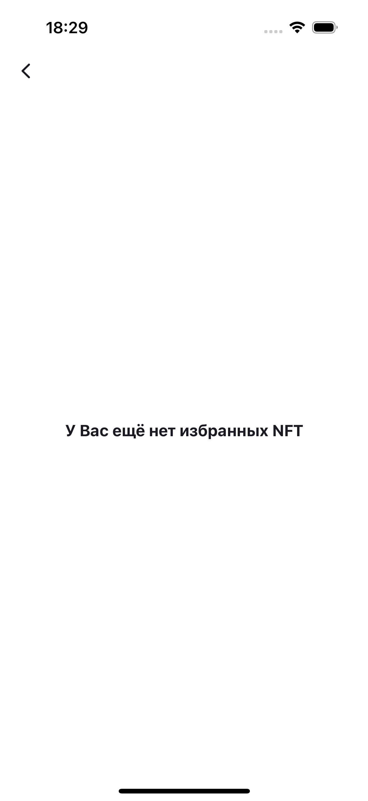
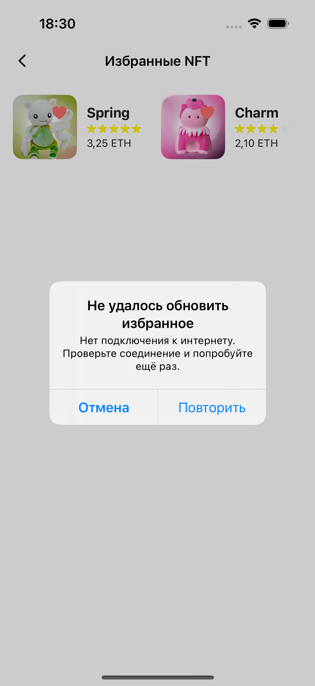
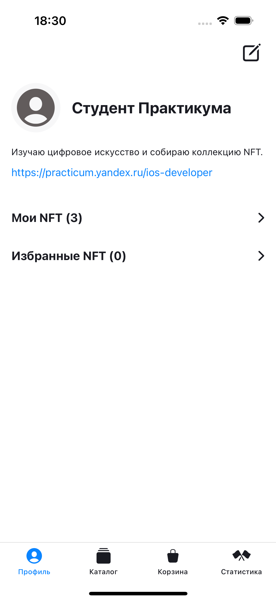

# Профиль — третья итерация (3/3)

Ответственный: AntonA22. [Эпик #36](https://github.com/shaggybee/iOS-FakeNFT/issues/36), [общая доска](https://github.com/users/shaggybee/projects/1).

PR третьей части: [#93 — Избранные NFT](https://github.com/shaggybee/iOS-FakeNFT/pull/93).

## Объём

Ветка feature/profile-iteration-3 создана от origin/epic/profile после слияния второй части (3642540). В коде присутствует весь эпик: профиль и редактирование, сайт с повтором открытия, «Мои NFT» с сохранением сортировки, «Избранные NFT» с удалением и актуальным счётчиком. Первые две части одобрены Kirchberg и слиты через PR #54 и #89.

Третья часть добавляет:

- переход из профиля, возврат и скрытие/восстановление таббара;
- LazyVGrid в две колонки; изображение 80×80, сердце, название, рейтинг и цена в ETH;
- получение избранного по свежему массиву likes, удаление повторяющихся ID, сохранение порядка и до четырёх одновременных запросов NFT; авторы для этого экрана не запрашиваются;
- удаление только после подтверждённого успешного PUT, обновление профиля и счётчика, пустой экран после последнего удаления;
- сохранение карточки при ошибке удаления, повтор именно операции удаления и отмену алерта;
- загрузку, пустой список, ошибку загрузки с повтором, pull-to-refresh и отмену задач при уходе;
- защиту от повторных мутаций, включая повторный вход в actor между await;
- общий компонент отображения удалённых и локальных изображений.

Новых надписей режима или дополнительных функций вне макета нет. Сердца на экране «Мои NFT» остаются индикаторами likes; удаление выполняется на экране избранного.

## Запросы и согласованность

Перед удалением сервис перечитывает профиль: добавленные после открытия экрана likes сохраняются. PUT содержит только likes; имя, описание, фото, сайт и nfts не отправляются. Непустой массив передаётся повторяющимися form-параметрами `likes=id1&likes=id2`, пустой — `likes=null`, как в реализации каталога команды. Общий NetworkRequest использует [URLQueryItem], совместимый с форматом каталога. FormURLEncoder сохраняет повторяющиеся ключи и кодирует кириллицу, +, & и =.

После подтверждения удаления ViewModel принимает профиль из ответа сервера и фильтрует карточки по его likes. Профиль обновляется через callback и перечитывается при возвращении на экран. Следующее открытие избранного снова читает профиль, поэтому учитывает изменения из других экранов. Новые избранные, добавленные другим клиентом во время текущего просмотра, появятся после обновления или повторного открытия.

GET и PUT не являются одной атомарной операцией: изменения другого клиента между ними не защищены версией/ETag со стороны этого API. При командной интеграции нужно согласовать единый сервис likes для экранов каталога и профиля.

При отмене PUT нельзя гарантировать, что сервер не успел его обработать. Локально неподтверждённое удаление не применяется; актуальное состояние восстанавливается следующим GET. Скрытого автоматического повторения PUT нет.

SwiftUI + MVVM, @Observable/@MainActor, actor/Sendable, async/await и структурированная конкурентность. Загрузки и повторы привязаны к `.task(id:)`, включая повторы основного профиля. Изменения профиля в редакторе по-прежнему формируются только из изменённых редактируемых полей. Минимальная iOS — 17.0.

## Источники

- [ТЗ SwiftUI](../Readme-SwiftUI.md), API.html и cloud.postman_collection.json.
- [Figma FakeNFT](https://www.figma.com/design/Uz5G39wRRCr2mRE4SbnNla/FakeNFT--YP-), экраны Favourites и No favourites. Полотно в Яндекс Браузере не поддавалось прокрутке инструментом; избранное дополнительно прочитано во встроенном браузере.
- [Критерии SwiftUI](https://code.s3.yandex.net/Mobile/iOS/diploma/PR_SwiftUI.pages): прочитана таблица из preview файла Pages.
- Текст урока спринта 26 предоставлен пользователем в чате.

## Запуск

Debug по умолчанию использует моковые сервисы без API-токена. Исходный профиль содержит три собственных NFT и два избранных (Spring и Charm); все изображения локальные. Можно удалить одно или оба избранных и проверить счётчик. Изменения демонстрационного профиля живут до перезапуска приложения; сортировка сохраняется в UserDefaults.

Для настоящего API — аргумент `--profile-live-api` и токен в игнорируемом Configurations/Secrets.xcconfig. Release использует только сетевые сервисы. [Подробные режимы и источники изображений](profile-demo-data.md).

## Проверка

Xcode 16.3, iPhone 16 / iOS 18.4. Полный прогон: **51 unit-тест и 15 UI-сценариев — без ошибок** (work/ProfileIteration3.xcresult). После сверки компактных карточек с Figma все пять новых UI-сценариев отдельно повторены — успешно (work/ProfileIteration3Visual.xcresult).

Проверяются реальные URLRequest через URLProtocol: PUT, Content-Type, повторяющиеся likes, пустой список и специальные символы. Unit-тесты также проверяют актуальный профиль перед удалением, сохранение остальных полей, дедупликацию и порядок, отсутствие лишних запросов, отказ сервера, повтор, отмену уже начавшегося запроса и защиту от дублирования. UI проверяет удаление последнего NFT, счётчик, возврат через «Мои NFT», пустое состояние, ошибки загрузки/удаления, повтор и отмену.

API при проверке с компьютера 03.11 вернул HTTP 200 для GET /api/v1/profile/1 и GET /api/v1/nft?page=1&size=1. В текущем профиле массивы nfts и likes пусты. Но реальный запрос URLSession из симулятора завершился **NSURLErrorDomain -1003 (cannotFindHost)** через интерфейс utun6. Поэтому дополнительный диагностический UI-сценарий настоящего API не прошёл; отдельный сетевой тест подтвердил DNS-причину. Эти два временных диагностических теста удалены из постоянного набора; журнал и xcresult сохранены вне репозитория. Успешная интеграция из симулятора с живым API пока не подтверждена.

Настройки VPN, DNS и TLS не менялись. Серверные PUT не выполнялись: изменение likes проверено изолированно через URLProtocol и моковые сервисы. После восстановления сети симулятора требуется проверить настоящий GET и согласовать безопасную проверку PUT на выделенных тестовых данных.

## Снимки и демонстрация

Все снимки и видео ниже — из сценариев на моковых данных.

| Избранное | Пустой список | Ошибка удаления | Счётчик после удаления |
|---|---|---|---|
|  |  |  |  |

[Короткий скринкаст: удаление, возврат и пустой список](profile/screencast/iteration-3.mp4).

## Сдача и дальнейшее объединение

Эта итерация готовит код полного эпика к ревью. Новое разрешение Kirchberg на слияние полного эпика ещё нужно получить. P12–P15 ожидают проверки; P16 включает ревью и остаётся в работе. [Декомпозиция](profile-decomposition.md), [учёт времени](profile-worklog.md).

После разрешения ревьюера третья часть сливается в epic/profile, затем эпик объединяется с командной develop. После объединения всех эпиков и проверки общей сборки команда сдаёт PR develop → main (в уроке ветка названа master; фактическая основная ветка репозитория — main). Эта финальная командная итерация не заменяется сдачей личного эпика. Общие ветки в рамках подготовки не изменялись.

После переноса повтора основного профиля на общий `.task(id:)` отдельно успешно проверены ошибка/повтор профиля, редактирование с сохранением и полный сценарий удаления избранного со счётчиком — work/ProfileIteration3ProfileRetry.xcresult.

Release-сборка для iOS Simulator прошла. В её бинарнике отсутствуют моковые сервисы (проверка символов); профиль в Release использует настоящий API.

## Результат ревью 06.11.2026

PR #93 получил APPROVED от Kirchberg; в Практикуме работа принята, критических замечаний нет. Ревьюер разрешил объединение эпика с командой. Две рекомендации про текущую локаль цены и новые ID избранного после удаления обработаны.

Финальный командный PR — [#94](https://github.com/shaggybee/iOS-FakeNFT/pull/94), `develop` → `main`. [Полный скринкаст профиля](profile/screencast/profile-epic.mp4) записан в проверенном объединённом приложении на моковых данных. Статистика ещё не включена в `develop`.
